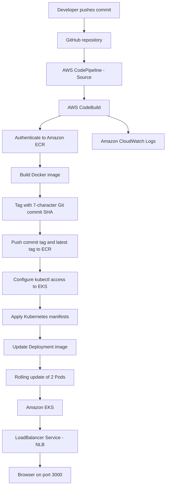

# MindTrack – React Application Deployment on AWS EKS

A production-style deployment of the **Brain Tasks (MindTrack) React application** using Docker, Amazon ECR, Amazon EKS, AWS CodeBuild, AWS CodePipeline and Amazon CloudWatch Logs.

The application is served by NGINX on **port 3000**. CodePipeline uses GitHub as its source and starts CodeBuild. The CodeBuild buildspec builds and pushes a commit-tagged Docker image to ECR, then deploys that image to EKS using `kubectl`.

## Project overview

| Item | Details |
|---|---|
| Application | Brain Tasks / MindTrack (React production build) |
| Original application repository | https://github.com/Vennilavanguvi/Brain-Tasks-App |
| Project repository | https://github.com/ksheregit/mindtrack-build |
| AWS Region | `ap-south-1` |
| EKS cluster | `guvi-eks` |
| Kubernetes namespace | `mindtrack` |
| Kubernetes Deployment | `mindtrack` |
| Kubernetes Service | `mindtrack-service` |
| ECR repository | `mindtrack` |
| Container / service port | `3000` |
| Deployment replicas | `2` |
| Container base image | `nginx:alpine` |

> **AWS account note:** Replace `<AWS_ACCOUNT_ID>` in commands below with the AWS account ID used by your environment. The repository's buildspec currently contains the account-specific ECR URI.

## Architecture



**Pipeline design:** CodePipeline has a Source stage and a Build stage. The Kubernetes deployment is performed by commands in the CodeBuild `post_build` phase; a separate CodePipeline Deploy stage is therefore not used. The Test and Deploy stages were skipped in the configured pipeline.

## Repository structure

```text
MindTrack_build/
├── dist/
│   ├── assets/
│   │   ├── index-BHGiHu50.js
│   │   └── index-DPTLVrPB.css
│   ├── index.html
│   └── vite.svg
├── k8s/
│   ├── deployment.yaml
│   └── services.yml
├── .dockerignore
├── .gitignore
├── Dockerfile
├── nginx.conf
└── buildspec.yml
```

The repository uses the already-built React/Vite production output in `dist/`; it does not run a Node.js build inside the Docker image. The Docker image copies `dist/` into the NGINX web root.

### Important files

| File | Purpose |
|---|---|
| `dist/` | Pre-built React production assets |
| `Dockerfile` | Builds a lightweight NGINX-based image and copies the production files |
| `nginx.conf` | Configures NGINX to listen on port 3000 and supports SPA route fallback |
| `k8s/deployment.yaml` | Defines the `mindtrack` Deployment with two replicas and a readiness probe |
| `k8s/services.yml` | Exposes the application using a Kubernetes `LoadBalancer` Service with an AWS NLB annotation |
| `buildspec.yml` | Defines the CodeBuild image build, ECR push and EKS deployment steps |
| `.dockerignore` | Keeps Git metadata, logs, documentation and Kubernetes/pipeline files out of the Docker build context |
| `.gitignore` | Excludes local dependencies, environment files, logs and private-key files |

## Prerequisites

Install and configure the following tools on the machine used for manual deployment:

- Docker
- AWS CLI
- `kubectl`
- Git
- An AWS identity with the required ECR and EKS permissions

Confirm the tools are available:

```bash
docker --version
aws --version
kubectl version --client
git --version
```

Configure AWS CLI credentials using your organisation's approved method. Do not commit AWS access keys, passwords, `.env` files or private keys to Git.

## 1. Clone the project repository

```bash
git clone https://github.com/ksheregit/mindtrack-build.git
cd mindtrack-build
```

The project repository contains the production `dist/` directory and deployment configuration files.

## 2. Build and run the Docker image locally

Build the image:

```bash
docker build -t mindtrack:local .
```

Start the container and map port 3000:

```bash
docker run -d --name mindtrack-test -p 3000:3000 mindtrack:local
```

Open the application:

```text
http://localhost:3000
```

Useful checks:

```bash
docker ps
docker logs mindtrack-test
```

Stop and remove the test container when finished:

```bash
docker stop mindtrack-test
docker rm mindtrack-test
```

## 3. Push the image to Amazon ECR manually (optional)

The automated pipeline performs these steps. They are included here for reference and for a manual first-time image push.

Set the region and account-specific registry:

```bash
AWS_REGION=ap-south-1
AWS_ACCOUNT_ID=<AWS_ACCOUNT_ID>
ECR_URI=${AWS_ACCOUNT_ID}.dkr.ecr.${AWS_REGION}.amazonaws.com/mindtrack
```

Create the repository if it does not already exist:

```bash
aws ecr create-repository \
  --repository-name mindtrack \
  --region "$AWS_REGION"
```

Authenticate Docker to ECR:

```bash
aws ecr get-login-password --region "$AWS_REGION" \
  | docker login --username AWS --password-stdin \
    "${AWS_ACCOUNT_ID}.dkr.ecr.${AWS_REGION}.amazonaws.com"
```

Tag and push the local image:

```bash
docker tag mindtrack:local "$ECR_URI:latest"
docker push "$ECR_URI:latest"
```

## 4. Deploy to EKS manually (optional)

The CodeBuild pipeline performs the deployment automatically. These commands describe the manual deployment path used to validate the Kubernetes manifests.

Update the local kubeconfig:

```bash
aws eks update-kubeconfig \
  --name guvi-eks \
  --region ap-south-1
```

Verify cluster access:

```bash
kubectl get nodes
```

Create the namespace if it does not already exist:

```bash
kubectl create namespace mindtrack \
  --dry-run=client -o yaml | kubectl apply -f -
```

Apply the Kubernetes manifests:

```bash
kubectl apply -f k8s/
```

Check the Deployment, Pods and Service:

```bash
kubectl get deployments -n mindtrack
kubectl get pods -o wide -n mindtrack
kubectl get services -n mindtrack
kubectl get endpoints mindtrack-service -n mindtrack
```

Wait for the Deployment rollout:

```bash
kubectl rollout status deployment/mindtrack \
  -n mindtrack --timeout=180s
```

### Kubernetes configuration

**Deployment (`k8s/deployment.yaml`)**

- Creates a Deployment named `mindtrack` in the `mindtrack` namespace.
- Runs two replicas of the application.
- Uses the ECR image and `imagePullPolicy: Always`.
- Exposes container port `3000`.
- Uses an HTTP readiness probe against `/` on port `3000`. Kubernetes only routes Service traffic to Pods that pass readiness checks.

**Service (`k8s/services.yml`)**

- Creates `mindtrack-service` with type `LoadBalancer`.
- Selects Pods labelled `app: mindtrack`.
- Exposes port `3000` and forwards traffic to target port `3000`.
- Includes the AWS load-balancer annotation `service.beta.kubernetes.io/aws-load-balancer-type: "nlb"` to request a Network Load Balancer.

Traffic path:

```text
Browser
  |
  v
AWS Network Load Balancer :3000
  |
  v
Kubernetes Service :3000
  |
  v
One of the ready MindTrack Pods :3000
```

## 5. CI/CD pipeline explanation

### Pipeline stages

| Stage | AWS service | What happens |
|---|---|---|
| Source | AWS CodePipeline + GitHub connection | Retrieves the latest source commit from GitHub |
| Build | AWS CodeBuild | Runs `buildspec.yml`, builds the Docker image and pushes it to ECR |
| Deployment commands | CodeBuild `post_build` phase | Connects to EKS, applies manifests, updates the image and waits for rollout |
| Monitoring | Amazon CloudWatch Logs | Stores CodeBuild execution output for troubleshooting and evidence |

A Git push to the connected GitHub source starts the pipeline. The CodeBuild project is configured with a GitHub source connection and CloudWatch logging. The CodeBuild project uses privileged mode so Docker image builds can run.

### What `buildspec.yml` does

The buildspec uses version `0.2` and defines these environment variables:

| Variable | Value / purpose |
|---|---|
| `AWS_REGION` | `ap-south-1` |
| `EKS_CLUSTER_NAME` | `guvi-eks` |
| `DEPLOYMENT_NAME` | `mindtrack` |
| `CONTAINER_NAME` | `mindtrack` |
| `ECR_URI` | ECR repository URI for `mindtrack` |

**PRE_BUILD**

1. Retrieves a temporary ECR login password and authenticates Docker.
2. Reads `CODEBUILD_RESOLVED_SOURCE_VERSION`.
3. Uses the first seven characters of the source commit ID as `IMAGE_TAG`.

**BUILD**

Builds the Docker image with two tags:

```bash
docker build -t $ECR_URI:$IMAGE_TAG -t $ECR_URI:latest .
```

The commit-specific tag identifies the source revision. The `latest` tag is also pushed as a convenience tag.

**POST_BUILD**

1. Pushes both image tags to ECR.
2. Runs `aws eks update-kubeconfig` for `guvi-eks`.
3. Applies the manifests from `k8s/`.
4. Updates the `mindtrack` Deployment to use the commit-specific image tag.
5. Waits for the Deployment rollout to complete, with a 180-second timeout.

The key deployment commands are:

```bash
kubectl apply -f k8s/

kubectl set image deployment/$DEPLOYMENT_NAME \
  $CONTAINER_NAME=$ECR_URI:$IMAGE_TAG -n mindtrack

kubectl rollout status deployment/$DEPLOYMENT_NAME \
  -n mindtrack --timeout=180s
```

Using a unique commit tag means a new source revision produces a changed image reference in the Deployment and triggers a Kubernetes rolling update. The rollout status command makes the CodeBuild job fail if the new Deployment does not become ready within the timeout.

## 6. IAM and EKS permissions

The CodeBuild service role used in this project is:

```text
codebuild-mindtrack-build-service-role
```

The role was configured with permissions for:

- Pushing images to Amazon ECR (`AmazonEC2ContainerRegistryPowerUser`).
- Describing the EKS cluster so CodeBuild can update kubeconfig (`mindtrack-eks-describe`).
- Accessing the GitHub connection (`mindtrack-github-connection`).
- CloudWatch logging and CodeBuild source connection operations.

An EKS access entry was created for the CodeBuild IAM role, with `AmazonEKSClusterAdminPolicy` at cluster scope for this project.

> **Security note:** Cluster-admin access is broad. For a long-lived production environment, replace it with least-privilege Kubernetes access scoped to the required namespace and operations. Review IAM policies before reusing this configuration.

## 7. Monitoring and verification

### CodeBuild / CloudWatch

The CodeBuild project sends build output to Amazon CloudWatch Logs. The logs provide evidence of:

- `DOWNLOAD_SOURCE` completion.
- Successful ECR authentication (`Login Succeeded`).
- Docker image build completion (`BUILD State: SUCCEEDED`).
- Commit-specific and `latest` image pushes.
- EKS kubeconfig update.
- Kubernetes manifest application.
- Deployment image update.
- Successful rollout (`deployment "mindtrack" successfully rolled out`).
- Final `POST_BUILD State: SUCCEEDED`.

Example log evidence from the supplied build:

| Check | Observed result |
|---|---|
| Commit image tag | `1f41c92` in the first supplied build log; `e020054` in the later log |
| ECR push | Both commit tag and `latest` pushed |
| EKS context | `guvi-eks` |
| Deployment update | `deployment.apps/mindtrack image updated` |
| Rollout | `deployment "mindtrack" successfully rolled out` |
| Build result | `POST_BUILD State: SUCCEEDED` |

The supplied CodeBuild log and CloudWatch log-stream capture are included under [`evidence/logs/`](evidence/logs/).

### Kubernetes checks

Run these commands to verify the live workload:

```bash
kubectl get pods -n mindtrack -o wide
kubectl get deployment mindtrack -n mindtrack
kubectl describe deployment mindtrack -n mindtrack
kubectl get service mindtrack-service -n mindtrack
kubectl get endpoints mindtrack-service -n mindtrack
kubectl rollout status deployment/mindtrack -n mindtrack
```

To inspect application container output:

```bash
kubectl logs deployment/mindtrack -n mindtrack
```

To check the image currently configured on the Deployment:

```bash
kubectl get deployment mindtrack -n mindtrack \
  -o=jsonpath='{.spec.template.spec.containers[?(@.name=="mindtrack")].image}'
```

## 8. Automatic deployment test

The automatic trigger was tested by making a visible application change to the page title (`Brain Task V2`) and pushing the change to GitHub.

The observed validation sequence was:

1. GitHub received the new commit.
2. CodePipeline started automatically.
3. Source and Build stages completed successfully.
4. CodeBuild built and pushed a new commit-tagged image to ECR.
5. CodeBuild updated the EKS Deployment to use the new image.
6. Kubernetes completed the rolling update.
7. The application displayed the updated title in the browser.

This validates the end-to-end GitHub → CodePipeline → CodeBuild → ECR → EKS deployment flow.

## 9. Application endpoint and AWS load balancer

The Kubernetes Service creates an AWS Network Load Balancer. Retrieve its hostname with:

```bash
kubectl get service mindtrack-service -n mindtrack
```

The `EXTERNAL-IP` field shows the load balancer hostname once AWS has provisioned it. Access the application using:

```text
http://<LOAD_BALANCER_DNS_NAME>:3000
```

**Application URL:** Add the final tested URL here.

**Network Load Balancer ARN:** Add the ARN from the EC2 / Load Balancers console here.

The exact application URL and load balancer ARN were not present in the supplied project notes/log extracts, so they are intentionally left as fields to complete rather than guessed.

## 10. Cleanup

The EKS cluster and associated resources can incur AWS charges. After collecting the required screenshots and evidence, remove resources that are no longer needed.

Before deleting anything, confirm whether the EKS cluster, node group, load balancer, ECR repository and CloudWatch log group are shared or used by another workload. Follow the assignment's cleanup instructions and your account's change controls.

The project notes identify deletion of the EKS node group and cluster as pending cleanup after evidence collection. No destructive cleanup command is included here to avoid accidental deletion.

## 11. Evidence and screenshots

Screenshots extracted from the project walkthrough are stored in [`evidence/screenshots/`](evidence/screenshots/). The folder-structure screenshot is available as [`evidence/project-folder-structure.png`](evidence/project-folder-structure.png).

See [`evidence/SCREENSHOT-INDEX.md`](evidence/SCREENSHOT-INDEX.md) for the numbered screenshot files.

## Project status

The project walkthrough records the application build, ECR push, EKS deployment, CodeBuild setup, CodePipeline integration, automatic trigger test and CloudWatch log verification as completed. The original checklist still listed final screenshot capture/documentation and AWS resource cleanup as follow-up tasks at the time it was written.

---

**Project:** MindTrack – React Application Deployment  
**Author:** Kannan Sudalai  
**Region:** AWS Asia Pacific (Mumbai) – `ap-south-1`
